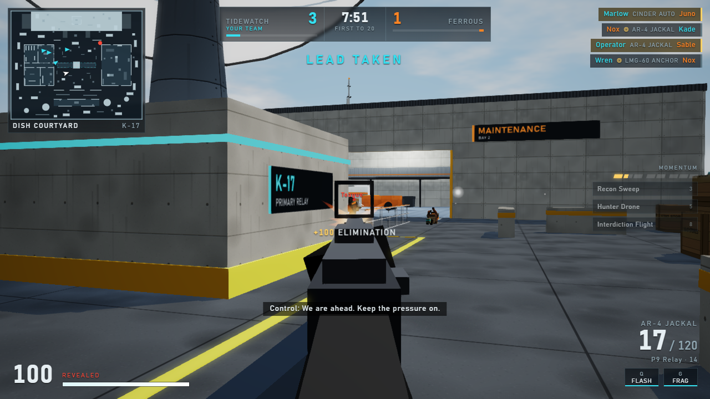

# Breachline

An original fast-respawn arcade military FPS for the browser. Two fictional security outfits — **Tidewatch Station
Security** and **Ferrous Recovery Group** — fight a 6v6 **Team Clash** over **Relay Station K-17**, an island
communications facility in the middle of a corporate evacuation.

This repository is a one-shot **vertical slice**: the complete offline Practice loop (menu → loadout → match →
death/respawn → results → progression → play again) against bots, running on the same authoritative
client/server architecture a hosted version would use. There is no backend: the match server runs in a Web Worker
inside your browser.



## Run it

Requires Node.js 22.12+ and npm.

```bash
npm ci
npm run dev        # http://localhost:5320
npm run build      # static site in dist/ (relative URLs - works from any sub-path)
npm run preview    # serve dist/ on http://localhost:5321
npm test           # headless simulation / rules / netcode tests (Vitest)
npm run shots      # optional: plays the built game in system Chrome/Edge and saves screenshots to oneshot/
```

Target: desktop Chrome or Edge with WebGL 2, keyboard and mouse, 1280×720 or larger. If WebGL 2, WebAssembly,
Web Workers or Pointer Lock are missing the game shows an explanatory error screen instead of starting.

## Controls

| Input | Action |
| --- | --- |
| `W` `A` `S` `D` / mouse | Move / aim (Pointer Lock, no acceleration) |
| Left mouse / right mouse | Fire / aim down sights |
| `Shift` | Sprint |
| `Ctrl` or `C` | Crouch (toggle or hold) |
| `Space` | Jump; mantle ledges 0.6–1.35 m high |
| `R` | Reload |
| `F` | Quick melee (two hits from full health) |
| `G` | Lethal equipment (hold to cook a Fragmentation Charge) |
| `Q` | Tactical equipment |
| `1` / `2` / mouse wheel | Primary / sidearm |
| `3` / `4` | Cycle banked support action / deploy it |
| `X` | Ping for your team |
| `Tab` | Scoreboard |
| `B` | Inspect weapon |
| `1`–`5` while down | Choose the loadout for your next life |
| `Esc` | Pause menu (the match keeps running) |

Every key is rebindable in **Settings → Controls**, with hold/toggle options for ADS, crouch and sprint.

## What is in the slice

- **Relay Station K-17** (≈116 × 96 m): west Operations Wing (corridors, control room, breakable glass), central
  Dish Courtyard with a sunken service tunnel, east Maintenance Bay with catwalks, the North Ridge marksman lane
  and the low-visibility Utility Route. Three lanes, four connectors, six spawn groups.
- **Team Clash**: 6v6 (configurable 1–6), first to 75 or 8 minutes, tied clock → 60 s sudden death (+5), 3 s
  respawns, spawn protection, regenerating health, death recap with hit timeline.
- **Arsenal**: six primaries (AR-4 Jackal, M7 Kestrel, BR-12 Mesa, SG-8 Breacher, LMG-60 Anchor, MR-1 Warden) and
  three sidearms, each with its own procedural model, recoil pattern, falloff and hit-zone multipliers; eleven
  attachments with explicit tradeoffs; nine perks; six equipment items; six Momentum support actions.
- **Bots** that play by the same rules as you: vision cones with occlusion and smoke, hearing, reaction delays,
  burst discipline, cover, equipment and support use. Easy / Normal / Hard change skill, never health or damage.
- **Loadout editor** (five slots, plain-language bars plus exact numbers), **profile** with levels 1–30, an unlock
  track, five onboarding challenges, per-weapon stats, export and reset.
- **Netcode you can see**: the client sends 26-byte input commands, predicts movement and weapon timing with the
  shared simulation, and reconciles against 20 Hz binary snapshots; remote players are interpolated; hitscan is
  lag-compensated. The Practice screen's **Latency lab** injects delay, jitter and loss so this can be felt.
- **Settings**: FOV 75–110, viewmodel FOV, sensitivity and ADS multiplier, quality presets, render scale, audio
  buses, key bindings, colour-blind accents, reduced motion, photosensitive flash, subtitles.

## Project layout

| Path | Brief module | Notes |
| --- | --- | --- |
| `src/content/` | content-data | weapons, attachments, perks, equipment, support actions, tuning, progression, K-17 map |
| `src/protocol/` | shared-protocol | versioned messages, binary input/snapshot codecs |
| `src/sim/` | shared-simulation | player step (movement, weapons, equipment), Rapier collision world, hit zones, nav grid |
| `src/server/` | game-server | authoritative room, bots, spawn director, Web Worker entry |
| `src/client/` | client-runtime | prediction, reconciliation, interpolation, input, transport, match loop |
| `src/render/` | renderer | Babylon.js scene, procedural map/textures/characters/weapons, effects |
| `src/audio/` | audio | Web Audio synthesis, spatial mix, music |
| `src/ui/` | client-ui | React shell, DOM HUD |
| `src/profile/` | profile-service (embedded) | local profile, idempotent result application |
| `tests/` | tools-tests | simulation, rules, netcode, map-metric, spawn and architecture tests |
| `tools/screenshot.mjs` | tools-tests | sub-path smoke run + screenshots of the production build |

## Demo / automation mode

`?demo=1` starts a Practice match immediately with a simple autopilot driving the local player through the normal
input, prediction and network path (no Pointer Lock needed). It exists for automated smoke tests and screenshots.
Optional parameters: `score=20`, `size=3`, `diff=easy|normal|hard`, `latency=good|typical|rough`, `loadout=0..4`.

See `ONESHOT-REPORT.md` for coverage of the brief, verification results and known limitations, and `ASSETS.md`
for asset sources and licenses.
