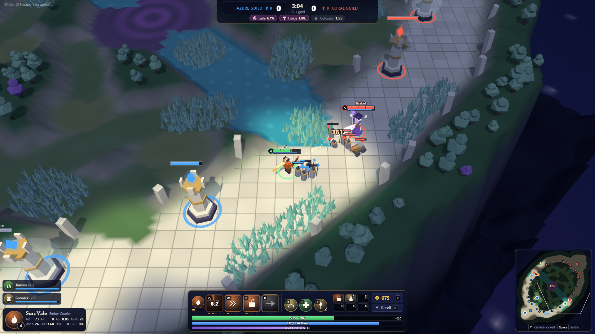

# Crownfall

An original browser lane-and-objective MOBA: **3v3 on The Broken Diadem**, a two-lane sky-island with
a mistwood jungle, a river, Twin Catalysts and the Aether Colossus. Break one lane's **Seal**, destroy
both **Core Towers**, then destroy the enemy **Crown Engine**.

This is a single-session **vertical slice**: you play one hero with two allied bots against three
enemy bots, from hero select to the results screen. The whole simulation is deterministic, fixed-step
and authoritative, and runs in a Web Worker behind a command/snapshot protocol — the renderer and UI
only ever see what your team is allowed to see.



## Run it

Requires Node.js 22.12+.

```bash
npm ci
npm run dev        # http://localhost:5340
npm run build      # type-checks, then writes a static site to dist/ (relative URLs, works from any sub-path)
npm run preview    # serves dist/ on http://localhost:5341
npm test           # 83 headless simulation / rules / fog / protocol tests (Vitest)
```

Browser tools (need Microsoft Edge or Google Chrome installed; they drive the **production build**
served from a nested sub-path):

```bash
node tools/screenshot.mjs        # captures oneshot/*.png
node tools/playtest.mjs          # 25 checks with real mouse + keyboard input
node tools/playtest.mjs full     # ...and then plays a whole fast-forwarded match to the results screen
node tools/variants.mjs          # smoke-checks low quality + colour-blind + 125% UI, and the in-process sim fallback
```

Target: desktop Chrome / Edge (Firefox should work) with WebGL 2, keyboard + mouse, 1280×720 or
larger. A clear error screen is shown if WebGL 2 is missing.

## How to play

1. **Play → pick a hero and two Talents → Lock In.** (Tutorial adds a guided checklist; Practice adds
   gold / level / time-scale tools.)
2. You start in your fountain: press **P**, buy the recommended starter, click **+** on an ability.
3. Walk to a lane, **last-hit** minions for gold, trade with the enemy hero, and keep your wave
   between you and the enemy tower. A red dashed line means a tower is aiming at *you*.
4. **B** recalls (7 s) so you can heal and spend gold. Items are bought only in the fountain.
5. Take towers in order (outer → inner → Seal Guard → Seal). A broken Seal adds **Vanguards** to your
   waves in that lane and exposes the two Core Towers, then the Crown Engine.
6. Contest the river: **Gale / Forge Catalysts** give team buffs, the **Aether Colossus** empowers
   minions near your heroes for a siege window.

### Controls

| Input | Action |
| --- | --- |
| Right-click ground / enemy | Move / attack (hold to keep moving) |
| **A** then left-click | Attack-move |
| **Q W E R** | Abilities (default: hold to aim, release to cast) |
| **Shift**+Q/W/E/R or the **+** buttons | Rank up an ability (Ctrl also works except Ctrl+W, which browsers reserve) |
| **D F** | Talents |
| **T** or **4** | Ward trinket · **1–6** item actives |
| **B** | Recall · **P** shop · **S** stop · **H** hold |
| **Tab** | Scoreboard · **G** ping (Alt+G / Alt+left-click: "on my way") |
| **Y** | Toggle camera lock · **Space** centre on hero · **F1** snap to hero |
| Arrow keys, screen edges, middle-drag | Pan camera (when unlocked) · mouse wheel zooms |
| **Alt** | Show attack range · **Esc** cancel aim / close shop / pause |

Cast mode (quick / quick-with-indicator / normal), key bindings, quality, UI scale, colour-blind team
colours, screen shake and volumes are in **Settings**.

## What is in the slice

- **Complete match loop**: menu → draft (hero, talents, bot difficulty, pace) → loading → match →
  victory/defeat → results (scoreboard, MVP, commendation, timeline, mastery) → requeue. Match history
  and cosmetic mastery persist in `localStorage`.
- **Six original heroes**, each with a passive and Q/W/E/R implemented in the simulation and covered by
  tests: Brannoch (tank), Suri Vale (marksman), Oru (support), Kesh (jungler), Ilyra Quill (mage), Vey
  (assassin). Six universal Talents, pick two.
- **The Broken Diadem**: two asymmetric lanes mirrored for team fairness, jungle with 4 small + 2 buff
  camps per side, river, brush, Colossus pit with a vision ledge. Terrain, collision, vision and
  the minimap are all generated from one signed-distance map.
- **Rules**: 30-second alternating waves (3 Guards + 3 Bolts, Siege every third), last-hit gold with
  shared XP, passive gold, towers with minion-first targeting / hero aggro / damage ramp / backdoor
  mitigation, ordered structure vulnerability, Seal respawn (once) and Vanguards, bounties, death
  recap, recall, fountain.
- **Vision**: server-side fog of war with line of sight, brush, wards (2 charges, 90 s, team cap,
  true-sight only) and a 100 ms grace; snapshots are filtered per team before they leave the sim.
- **Shop**: all 32 items (6 starters, 10 components, 12 completed, 2 boot upgrades, 2 consumables),
  recipes, buy / undo / sell (65%), search, filters, two explained build paths per hero and a
  situational defensive suggestion.
- **Bots** that use the same command path and vision as a player: lane, last-hit, harass, push,
  avoid towers, retreat, recall-and-buy from build graphs, jungle, gank, defend, ward, contest
  objectives. Easy / Normal / Hard change reaction, aim and tolerance — never stats.
- **Presentation**: Three.js renderer with instanced minions/trees/brush, procedural original models,
  pooled particles and telegraph decals, fog-of-war shading, health bars with shields and CC labels,
  aim indicators (including Suri's ricochet preview), synthesised SFX and adaptive music.

See `ONESHOT-REPORT.md` for exactly what is and is not done, and `docs/ARCHITECTURE.md` for the module
map, protocol, bot behaviour and the accessibility checklist.

## Project layout

```
src/shared/   content + protocol: map (SDF, nav, LOS), heroes, items, units, commands, snapshot views
src/sim/      authoritative simulation: world tick, combat, hero commands, abilities, vision, server, worker
src/ai/       bots (server-side, same rules as players)
src/client/   runtime (link, store, persistence), input, renderer (Three.js), audio (Web Audio), React UI
tests/        deterministic fixtures for rules, abilities, fog, protocol, bots and whole matches
tools/        Playwright-driven screenshot + real-input playtest scripts for the production build
```

Everything visible and audible is generated in code; see `ASSETS.md`.
