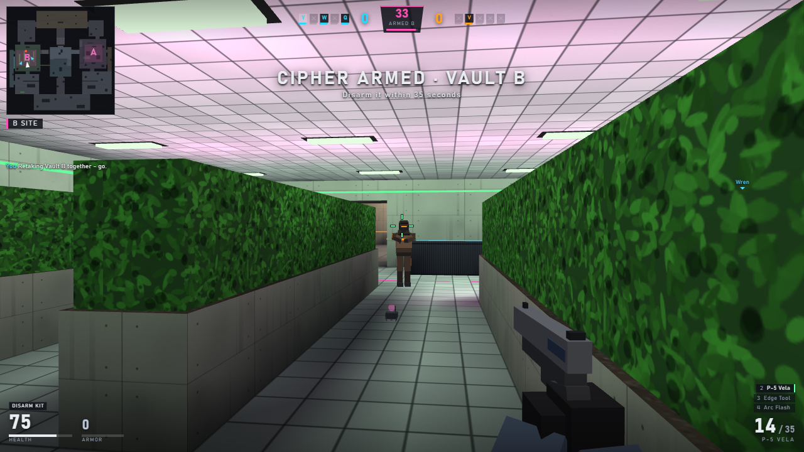

# Last Protocol

An original browser tactical shooter: **Cipher Breach**, 5v5, on **Aperture Annex**.

The Intrusion team carries a Cipher Spike and must arm it at Vault A or Vault B. The Custodian team stops the arm or disarms the Spike. One life per round, money carries between rounds, guns are lethal, and stopping before you shoot matters.

This repository is a **playable vertical slice**: one human against and alongside server-side bots, with the whole authoritative simulation running locally in the page. There is no backend, account, network call, analytics or tracker.



## Run it

Requires Node.js 22.12+ and npm.

```bash
npm ci
npm run dev        # http://localhost:5330
npm run build      # type-checks, then writes a static site to dist/
npm test           # 96 headless simulation and rules tests (Vitest)
```

`dist/` is fully static and uses only relative URLs, so it can be served from any sub-path.

Optional checks that drive the production build in a headless Chromium (uses an installed Edge or Chrome through `playwright-core`; nothing is downloaded):

```bash
npm run verify:browser   # 20 scripted end-to-end checks with real key and mouse events
npm run screenshot       # recaptures the screenshots in oneshot/ from dist/ served on a nested sub-path
```

Target: desktop Chrome or Edge with WebGL 2, keyboard and mouse, 1280x720 or larger. A clear error screen is shown if WebGL 2 is missing.

## Controls

| Key | Action |
| --- | --- |
| W A S D | Move |
| Mouse | Aim (Pointer Lock, raw deltas where the browser allows) |
| Left click | Fire, or throw the selected utility |
| Right click | Scope (Longglass M2, Sable DMR), or a soft lob with utility in hand |
| Shift | Walk silently |
| Ctrl or C | Crouch |
| Space | Jump |
| R | Reload |
| E | Hold to arm or disarm the Spike; swap for a weapon on the floor |
| B | Buy menu (in your spawn, during the buy phase) |
| Enter | Ready up: ends the buy phase early |
| 1 / 2 / 3 | Primary / sidearm / Edge Tool |
| 4 - 7 | Utility slots |
| Q, mouse wheel | Last weapon, cycle weapons |
| G | Drop the held weapon (with the tool out: drop the Spike) |
| F | Inspect |
| Tab | Scoreboard and team economy |
| M | Tactical map |
| Esc | Pause (the local match server pauses too) |
| F3 | Performance overlay |

In the buy menu: `1`-`6` picks a category, then `1`-`5` buys; `0` goes back; right-click an item bought this round to refund it.

Crouch + forward is Ctrl+W, which closes a browser tab. The match asks for fullscreen and locks the keyboard to stop that, and a leave-page confirmation is a second net. If you play windowed, use `C` to crouch.

## What is in the slice

- **Complete Cipher Breach loop**: menu, 20 s buy phase behind barriers, 1:45 action, 3.2 s arm, 35 s Spike timer with an accelerating beep, 8 s / 5 s disarm, round results, economy, side swap, overtime rule, match result. Quick (first to 5) and Full (first to 9, swap after 8, win by 2, max 20) lengths.
- **Aperture Annex**: an original two-vault map with a split-level mid, a gantry, a glass corridor, a crouch-only crawl, a penetrable service wall, staging areas and buy-phase barriers. Collision, rendering, navigation and the tactical map are all generated from one definition.
- **All 12 firearms plus the Edge Tool**, each with its own damage, armor penetration, falloff, fire mode, fixed recoil path, spread model and procedural model and sound. Scopes, burst fire, pump and bolt actions, wall penetration by material.
- **All five utility items**: Veil Canister, Arc Flash, Thermite Vial, Pulse Shard, Fragment Charge, on one deterministic projectile simulation.
- **Economy**: $800 start, $12,000 cap, win and escalating loss rewards, arming and disarm rewards, kill rewards by weapon class, refunds, weapon drops and pickups, survivor carry-over.
- **Nine bots** (four teammates, five opponents) running on the server side with line-of-sight vision, uncertain hearing, a team blackboard, buy logic, staged site takes, rotations, post-arm holds, retakes, disarms and utility throws. Three difficulties.
- **Authoritative room architecture**: 64 Hz simulation, sequenced inputs, 32 Hz filtered snapshots, client-side movement prediction and reconciliation, remote interpolation, 200 ms-capped lag compensation, an interest filter that withholds unseen enemies. It runs in-process behind a transport that can simulate latency, jitter and loss.
- **Practice mode**: unlimited funds, buy anywhere, ten-minute rounds and a live utility trajectory preview.
- **Interface**: React menus, buy menu, scoreboard, pause, results with round timeline and economy chart, local match history; a non-React in-frame HUD with minimap, tactical map, kill feed, radio feed, captions and a configurable crosshair.
- **Settings** persisted locally: sensitivity, scoped multiplier, FOV 80-105, crosshair editor, colour-blind team palettes, reduced flash, reduced motion, captions, toggle crouch/walk, left-handed viewmodel, render scale, volumes.
- Everything visual and audible is generated procedurally at load time; see `ASSETS.md`.

What is deliberately not here (online multiplayer, matchmaking, accounts, rating, replays viewer, reconnect) is listed honestly in `ONESHOT-REPORT.md`.

## Deep links

Appended to the page URL, mainly for capture and testing:

- `?autostart=quick|full|practice` starts a match immediately; `&side=atk|def`, `&difficulty=easy|normal|hard`, `&seed=123`.
- `&autopilot=1` hands your seat to a bot (attract mode; this is how the gameplay screenshots are captured).
- `&lag=50` adds 50 ms of one-way latency with jitter and 1% loss to the local transport, to exercise prediction.

## Project layout

```
src/
  content/     weapon table, utility, equipment, match rules (ruleset version)
  protocol/    versioned message, snapshot and event types
  map/         collision world, map builder, Aperture Annex, navigation grid
  sim/         movement, hit volumes, projectiles, vision, the Match (rounds, combat, economy, objective)
  bots/        perception, team planning, combat, utility, buying
  server/      authoritative Room: tick loop, input validation, history, snapshot interest filter
  netcode/     transport with a network-condition lab, client session (prediction, interpolation)
  renderer/    Babylon.js scene, baked-lighting map mesher, procedural models, effects, viewmodel
  audio/       synthesized sound engine
  client/      game loop, input, settings
  ui/          React shell and the DOM HUD
tests/         Vitest suites: economy, objective, combat, movement, map analysis, netcode, bots
tools/         screenshot and scripted browser playtest; balance and trace probes
```

`src/sim`, `src/map`, `src/bots`, `src/server` and `src/netcode` have no dependency on the browser or the renderer, which is why whole matches run in the test suite.

## License and assets

Code in this folder was written for this project. Third-party packages keep their own licenses; see `ASSETS.md`.
