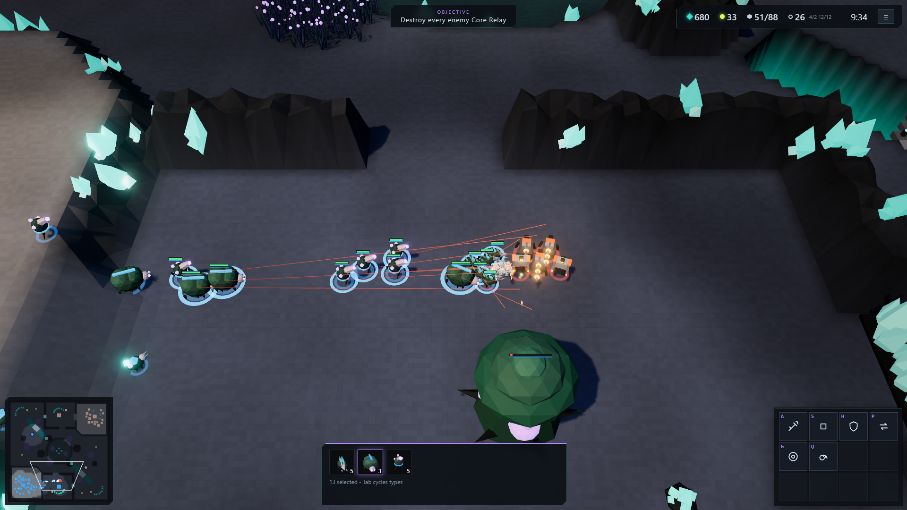

# Shardfront

An original browser real-time strategy game: a playable vertical slice built in one unattended session for
Oneshot Arcade. Two asymmetric factions fight over the energy wells of a fractured moon on one 1v1 map,
**Glass Ravine**. Harvest Prism Ore and Flux, build a base, scout through the fog, tech up, expand, and destroy
every enemy headquarters.

Everything is generated by code: models are assembled from primitives, the map is authored procedurally, and
all audio is synthesised. There are no external assets, accounts, backends or telemetry.



## Run it

Requires Node.js 22.12+ and npm.

```bash
npm ci
npm run dev        # dev server on http://localhost:5300
npm run build      # type-check + static production build in dist/ (relative URLs, works from any sub-path)
npm test           # headless simulation / rules test suite (Vitest)
npm run preview    # serve the production build on port 5300
```

Extra tools:

```bash
npm run serve        # serve dist/ under /play/claude-fable-5.2-high/shardfront/ (sub-path check)
npm run screenshot   # browser smoke test + captures into oneshot/ (needs Edge or Chrome installed)
npm run bench        # headless simulation benchmark (220 and 400 unit battles)
npm run balance      # AI-vs-AI balance tournament (SEEDS=1,2,3 DIFF=normal)
```

Target: desktop Chrome / Edge with WebGL 2, keyboard and mouse, 1280x720 or larger.
URL parameters for quick starts: `?autostart=skirmish&faction=helix|chorus&enemy=...&difficulty=easy|normal|hard&seed=N`,
`?autostart=tutorial`, `?autostart=spectate`.

## What is in the slice

- **Skirmish vs AI** (Easy / Normal / Hard) with either faction, **Tutorial** (12 validated steps),
  **Spectate AI vs AI**, **Replays** with hash verification, **Tech Archive**, **Settings**, post-game summary
  with graphs, timeline and rematch. A quiet AI match plays behind the main menu.
- **Helix Directorate**: Fabricator, Kestrel, Bulwark, Arc Lancer, Mender Rig, Mortar Crawler, Aegis Frame;
  Core Relay, Grid Pylon, Assembly Bay, Signal Foundry, Sentry Arc, Flux Tap.
- **Verdant Chorus**: Tender, Glimmerwing, Thornling, Sporecaster, Carapace Guard, Bloom Sage, Rift Stag,
  Crownbeast; Heartgrove, Root Node, Brood Hollow, Memory Bloom, Needle Pod, Flux Tap.
- Two-resource worker economy with seam reservation, 1.6 s gathers, visible cargo, saturation readout,
  supply, construction fields, production queues that pause visibly when supply-blocked, rally points,
  three attack and three armor upgrades over two tiers.
- Fog of war with high ground, vision-blocking brush, last-known enemy structures, Watch Pylons, salvage pods,
  destructible crystal barriers, and an 18-minute endgame (+15% yield, map-wide reveal pulse every 90 s).
- Deterministic 20 Hz simulation with a versioned command protocol, 2-tick input delay, state hashes and replays.

## Controls

| Input | Action |
| --- | --- |
| Left click / drag | Select / box-select. Double-click or Ctrl+click: all of that type on screen. Shift: add or remove. |
| Right click | Context order: move, attack, harvest, repair/assist, follow, set rally. Shift queues. Alt forces a plain move. |
| A, S, H, P, G | Attack-move, stop, hold position, patrol, guard a friendly unit |
| B then Q W E T D Z | Worker build palette: supply, production, Flux Tap, tech, defence, headquarters |
| Q W E T D Z | Train / research on a selected structure; Q is also the unit ability (Brace, Curl, Weld, Sensor Spike, Mend Spores) |
| R / X | Rally-point mode / cancel last queued item or a construction |
| Ctrl+1-9 (or Alt+1-9) | Assign control group. 1-9 recalls, Shift+number adds, double-tap centres the camera. |
| Arrow keys, middle-drag, wheel | Pan and zoom. WASD also pans **while nothing is selected** (with a selection those keys are commands). Shift pans faster. Edge scrolling is an option. |
| Tab / F / Space / Home / . | Cycle unit types, focus selection, jump to last alert, jump to base, next idle worker |
| Esc / F10 | Cancel the current mode, or open the pause menu |
| ` (backquote) | Performance panel with a nav / vision surface overlay |

All bindings except the number row and Esc can be remapped in Settings. Browsers reserve Ctrl+number for tab
switching, so Alt+number is accepted as well.

## Architecture (short)

Single TypeScript package, modules with one-way dependencies (`tests/data.test.ts` enforces the boundary):

```
src/sim      deterministic simulation: SoA entity state, commands, orders, combat, production, vision, victory
src/data     schema-validated balance tables (units, structures, tech, abilities) and tooltip text
src/world    Glass Ravine map generator (flags, elevation, resources, sites) and height sampling
src/nav      grid A* with string pulling over dynamic occupancy
src/ai       utility AI issuing the same validated commands as a player, limited to its own fog
src/net      versioned command protocol, replay format, fog-filtered snapshots
src/render   Three.js renderer: instanced entity views, shader patches, terrain, GPU particles, overlays
src/input    camera rig, pointer/keyboard mapping, selection, command card
src/audio    Web Audio mixer, synthesised one-shots, generative adaptive score
src/ui       React menus and HUD observing a small external store
src/game     match session (fixed clock, input delay, replay record/verify, alerts), tutorial director
src/persistence  IndexedDB repository (profile, settings, history, replays) with in-memory fallback
src/app      boot, capability detection, routing, settings
tools/       static sub-path server, screenshot/smoke script, benchmark, balance simulator
```

The simulation has no DOM, rendering or wall-clock dependency and runs headless in Node (that is how the
tests, benchmark and balance tool run). The renderer only reads simulation state; the UI only dispatches
protocol commands. See `ONESHOT-REPORT.md` for coverage, verification evidence, deviations and known issues,
and `ASSETS.md` for the asset manifest.

## Browser support

| Browser | Status |
| --- | --- |
| Edge / Chrome (desktop, WebGL 2) | Verified headless (Edge, software WebGL) through `npm run screenshot` |
| Firefox | Expected to work (standard WebGL 2 / Web Audio / IndexedDB only); not tested |
| Safari | Best effort; not tested |
