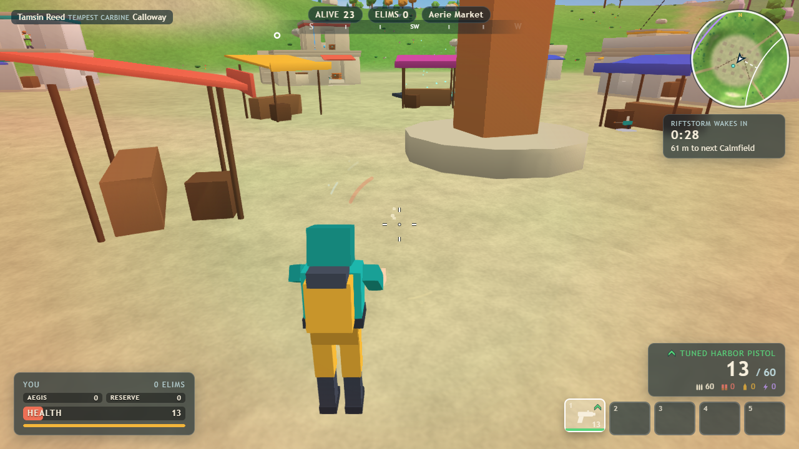

# Skybreak

An original browser battle royale: ride the transit skiff over **the Highwake**, drop on your wing-sail, loot weapons
and shields, rotate through the shrinking **Calmfield** while the **Riftstorm** closes, and be the last survivor of 24.

This is a one-shot vertical slice built for Oneshot Arcade. It runs entirely in the browser: the authoritative match
simulation (30 Hz, 23 server bots) runs in-process behind the same input/snapshot protocol a networked server would use.
There is no backend, no account and no telemetry.



## Run it

Requires Node.js 22.12+ and npm.

```bash
npm ci
npm run dev        # http://localhost:5350
npm run build      # static site in dist/ (relative URLs, works from any sub-path)
npm run preview    # serves dist/ on http://localhost:5350
npm test           # 54 headless simulation / rules tests (Vitest)
```

Extra tooling:

```bash
npm run soak -- 8 standard   # headless 24-bot matches: winner, phases, server tick cost
npm run loot-report          # weapons per player, chest density, rarity mix per location
npm run storm-seeds          # Calmfield centres for several seeds, nesting + land-cover check
npm run screenshot -- all    # real captures from the production build, served from a nested sub-path
```

Target: desktop Chrome / Edge with WebGL 2, keyboard and mouse. A clear error screen is shown if WebGL 2 is missing or
the graphics context is lost.

## Controls

| Action | Default |
| --- | --- |
| Move | `W A S D` |
| Aim / fire (or use the selected item) | Mouse / left click |
| Aim down sights | Right click (hold, or toggle in Settings) |
| Sprint (5 s energy) | `Left Shift` |
| Crouch, slide while sprinting | `Left Ctrl` or `C` |
| Jump, mantle ledges 0.6-1.5 m | `Space` |
| Interact: pick up, open, ride ascender / zipline. Hold to swap when full | `E` |
| Reload / quick melee | `R` / `F` |
| Inventory slots | `1`-`5`, mouse wheel |
| Throw selected utility (selects one first if needed) | `G` |
| Deploy / stow wing-sail | `Z` |
| Swap camera shoulder | `X` |
| Full map (click to place a marker) / inventory | `M` / `Tab` |
| Ping marker at the crosshair | Middle click |
| Free look | `Left Alt` |
| Ready up on the staging pier | `Enter` |
| Pause, settings, key binds | `Esc` |

Every keyboard action can be rebound in Settings > Key binds. Browsers reserve `Ctrl+W`; Skybreak asks for
confirmation before the tab closes mid-match and also binds crouch to `C`.

## What is in the slice

- **Complete loop:** menu > Quick Drop > 35 s staging pier > seeded skiff route > map marker > jump > freefall >
  wing-sail (auto-deploy at 75 m or manual) > loot > fight > rotate > last survivor > results > drop again.
- **The Highwake:** a 1.2 km island with six named locations (Aerie Market, Sunken Array, Kilnworks, Orchard Steps,
  Wind Abbey, Breaker Docks) and eight landmarks, built from an authored kit with building interiors, rooftops,
  ziplines, ascenders, air vents and heat-channel hazards.
- **24-player Solo** with 23 bots that drop, loot, heal, rotate and fight using sight cones, line of sight, gunfire
  and damage direction. Standard pace follows the brief's storm table; **Blitz** compresses the same phases to ~6 min.
- **Movement:** walk / run / sprint with energy, crouch, slide, jump, mantle, swim, fall damage, ziplines, ascenders,
  air vents with sail redeploy, freefall, glide, grapple.
- **Combat:** 100 Health + 50 recharging Aegis + 50 Reserve Shield; nine weapons (hitscan and projectile), five rarity
  tiers with shape-coded markers, four ammo types with caps, hit zones, falloff, deterministic recoil, seeded bloom,
  camera-ray aim with a muzzle obstruction check, lag-compensated hit tests.
- **Items:** Med Injector, Trauma Kit, Shield Flask, Aegis Cell, Mist Capsule, Grapple Spool, Echo Beacon, Wind Orb.
- **Loot:** floor loot, resonance chests, supply lockers, the Kilnworks vault, death caches with exact inventories,
  falling supply capsules and a shielded caravan drone.
- **Storm:** all phases from the brief, nested fields planned back-to-front onto validated final centres, moving
  endgame field and final collapse.
- **Practice Range:** every weapon (racks climb a rarity tier on each restock) and item, target dummies with damage
  readout, mantle crates, ascender tower, zipline, air vent, swim stairs.
- **Interface:** HUD (vitals, five slots, ammo, compass, minimap, storm timer, kill feed, hit markers, damage
  direction, damage numbers), full map, inventory with stats and drag-to-swap, spectating, results with timeline and
  route, appearance, local career / mastery, settings and accessibility options.
- **Presentation:** everything is procedural: models, sky, sea, storm, icons, and a synthesised soundscape and score.

See `ONESHOT-REPORT.md` for honest coverage, verification and known issues, and `docs/` for architecture, the threat
model and generated reports.

## Project layout

```
src/shared/      protocol, content tables (weapons, rarity, items, loot, storm, movement), island source, collision, nav
src/server/      authoritative match (lifecycle, movement, combat, loot, storm), interest management, bots
src/client/      loopback link, input, renderer (Babylon.js), audio (Web Audio), React UI
tests/           Vitest suites for rules and simulation
tools/           bot soak, loot report, storm seeds, screenshot capture
docs/            architecture, threat model, accessibility, compatibility, generated reports
```
