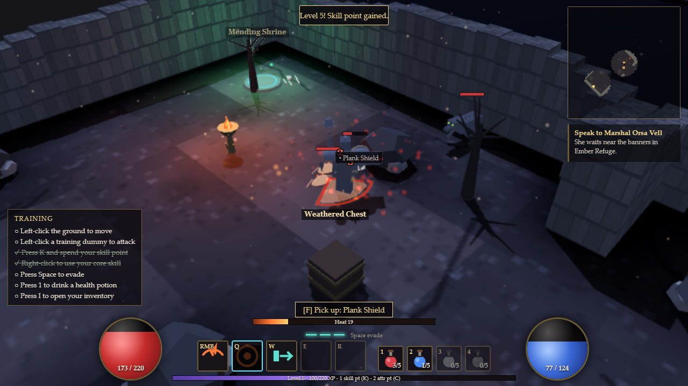

# Ashfall Covenant

An original isometric browser action RPG - a playable vertical slice built from a single brief.
You are a Warden in the ash-covered frontier of Varrow, where a buried star has corrupted beasts, dead settlers and ancient machines.
Fight through a seeded wilderness, rescue the Artificer from a crypt, break two bosses, and chase better loot on a harder expedition.



## Run it

Requires Node.js 22.12+ and a desktop Chrome/Edge/Firefox with WebGL 2.

```bash
npm ci
npm run dev        # http://127.0.0.1:5510
npm run build      # static site in dist/ (relative URLs - works from any sub-path)
npm test           # headless Vitest suite (simulation, world generation, loot, saves, end-to-end story flow)
npm run typecheck  # strict TypeScript
npm run preview    # serves dist/ on :5511
```

`dist/` is a fully static site: host it anywhere, including a sub-path such as `https://host/play/claude-sonnet-5.5-high/ashfall/`.
Single-player needs no server. Saves live in the browser's IndexedDB.

Optional developer helpers (not needed to play):
`?autostart=cinder` or `?autostart=ranger` skips the menu with a fresh character;
`window.__ashfall` exposes the running app for automation; `node tools/capture.mjs` re-creates the screenshots in `oneshot/` from the production build (needs Chrome or Edge installed).

## Controls (all rebindable in Settings)

| Input | Action |
| --- | --- |
| Left-click ground / hold | Move (path-finds, re-plans around corners) |
| Left-click enemy | Basic attack - walks into range and keeps attacking while held |
| Left-click NPC / object / ground label | Interact / pick up |
| Right-click | Core skill (assigned in the skill panel) |
| Q W E R | Active skills at the cursor |
| 1 2 3 4 | Potions: health, focus, cleanse, resistance tonic |
| Space | Evasive step (3 charges, 2.8 s recovery) - brief, no invulnerability |
| F | Interact with / pick up the nearest thing |
| T | Town gate (3 s channel, interrupted by damage or moving) |
| I / K / C / J | Inventory, Skills, Character, Quest log |
| Tab / M | Automap overlay / full map |
| Shift (hold) | Stand still while attacking |
| Alt (hold) | Show every ground label |
| Ctrl (hold) | Compare items (comparison is also on by default) |
| Mouse wheel | Zoom 13-24 m (boss arenas stay at 16 m or further) |
| Esc | Close panel / pause menu |

Settings also has a left-handed key preset, an "attack in place" toggle, UI scale (100/125/150%), colourblind telegraph patterns,
reduced motion / flashes, shake and particle sliders, shadow/quality presets with dynamic resolution, and per-bus audio volumes.

## What is in the slice

* **Two complete classes** - *Cinder Vow* (armoured battlemage: Heat from damage taken, mace + shield or two-handed maul, six actives, six passives, two exclusive capstones) and *Veil Ranger* (bow, Trace marks, traps, six actives, six passives, two exclusive capstones). Levels 1-20, skill points every level, attribute points every other level, respec (free through level 8), two loadout snapshots.
* **Ember Refuge** - safe hub: waypoint, quest giver, vendor, healer, stash, Artificer station (unlocked by the rescue), training dummies with a live DPS meter, east gate, post-victory Ashen Portal.
* **The Soot March** - a 4x4 tile graph built per seed from 20 authored tile recipes (10-12 chosen tiles, guaranteed loop, a closed shortcut gate, anchors: refuge gate, waypoint shrine, ruined tollhouse with elite, optional hunter camp with ambush event, crypt gate vista and the Toll-Keeper arena). Every seed is validated by tests.
* **Hollow Archive** - three floors: Lower Stacks (spike traps, undead machines, the caged Artificer), Scholars' Gallery (corrupted scholars, elite guardian, lever + barred-gate shortcut), Engine Approach (checkpoint waypoint and the final arena).
* **Combat** - fixed 30 Hz simulation with render interpolation, telegraphed hazards (circle / cone / ring / line) that fill as they charge, projectiles, status effects, crits, hit-stop, block, Guard, marks, traps, knockback/pull/root/stun with diminishing returns, boss stagger meters, Echo death mechanic.
* **Enemies** - 10 normal families with distinct behaviours (swarm, slam bruiser, kiting archer, ward-raising scribe, exploding mite, hooking pilgrim, shield warden, splitting quill swarm, flanking lunging hound, zone-laying adept), elite packs with modifiers (Ember Wake, Frost Pulse, Rallying, Mirror Shell), melee attack-slots and heavy-attack tokens so fights stay readable.
* **Bosses** - *The Toll-Keeper* (breakable armour meter, chain sweeps, gate slams, lantern adds, hook-and-reel, a Veteran-only Toll Quake) and the three-phase *Orison Engine* (rotating beam lanes + repair scribes; shielded phase with three conduits and delayed Blight quadrants; slower beams with a stagger race against Overload). Checkpoint before the arena, no cutscene on retry.
* **Loot** - 76 base items (64 pieces of gear plus 12 glyph tiers), 47 affixes in tiered prefix/suffix pools with exclusion groups, four rarities (Worn / Tempered / Inscribed / Relic), eight original Relics with unique powers, glyphs and sockets, identification, salvage, affix reroll with escalating cost, repair, 10x6 grid inventory with 1x1 / 1x2 / 2x3 items, comparison tooltips, favourites and confirmation guards, stash, vendor. Loot is seeded per run; bosses guarantee Inscribed-or-better and Relics have bad-luck protection.
* **Progression** - quests (Light the Ashway -> Break the Toll -> The Trapped Artificer -> Silence the Orison Engine, plus the optional Hunter's Cache), victory summary, Veteran difficulty, Target Hunt routes to either boss with recorded times, fresh seeded expeditions.
* **Presentation** - procedural low-poly art in a charcoal / bleached-stone / oxidised-brass / cyan star-metal palette, baked-AO floors, instanced walls with occlusion lowering, capped dynamic lights, GPU-point particles, adaptive procedural music, spatial synthesised SFX with distinct telegraph cues, a full HUD (orbs, skill bar, belt, XP, minimap, boss bar, buffs, tutorial) and every panel listed above.
* **Persistence** - versioned, checksummed IndexedDB saves with a rolling backup and interrupted-write recovery.

## Project layout

```
src/sim/       deterministic simulation (no DOM): game session, combat, AI, bosses, world generation, loot, inventory, character
src/data/      content tables: skills, enemies, items/affixes/relics, quests
src/render/    three.js view: scene, procedural models/props, textures, telegraph decals, particles
src/ui/        HUD, panels, menus, tooltips, icons, settings
src/audio/     Web Audio synth: buses, ducking, voice limiting, adaptive music
src/persist/   IndexedDB repository, checksum, migrations, backup recovery
tests/         Vitest suites (see ONESHOT-REPORT.md)
tools/         static server, headless-browser harness and screenshot capture
```

See `ONESHOT-REPORT.md` for architecture notes, verification results, deviations from the brief and known limitations, and `ASSETS.md` for asset provenance.
