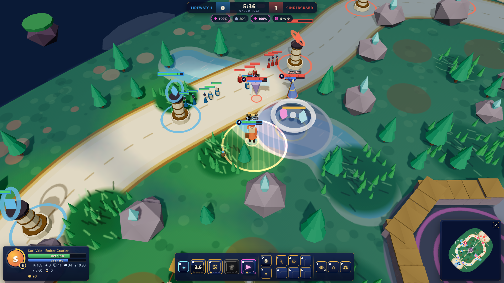

# Crownfall

An original browser lane-and-objective MOBA. Two guilds (**Tidewatch** and **Cinderguard**) fight over a shattered sky-island,
**The Broken Diadem**: push lanes, farm last hits, buy items, take neutral objectives, break a **Seal**, destroy both **Core
Towers**, then destroy the enemy **Crown Engine**. This build is a single-player 3v3 vertical slice: you and two bot allies
against three bots, with a complete loop from menu to results.



## Run it

Requires Node.js 22.12+ and npm.

```bash
npm ci
npm run dev       # dev server on http://127.0.0.1:5540
npm run build     # type-check + static site in dist/ (relative URLs; works from any sub-path)
npm test          # 47 headless tests (simulation, rules, bots, hero kits, protocol)
npm run preview   # serve dist/ on http://127.0.0.1:5541
```

Target browsers: desktop Chrome / Edge (Firefox works in principle), WebGL 2, keyboard and mouse, 1280x720 or 1920x1080.
If WebGL 2 is missing the game shows an error screen instead of a blank page. No backend is needed: everything runs in the
browser and the build is plain static files.

## What is in the slice

- **Menu, Tutorial, Play (hero draft), Heroes, Items, Match History, Settings, Credits.** The menu background is a live bot match.
- **Hero draft:** six original heroes with role/difficulty/kit/builds, two universal Talents (D / F), bot difficulty. Allies
  cannot duplicate; the enemy may mirror you.
- **Six heroes, all fully implemented** (passive + Q/W/E/R, data-driven tooltips, bot usage):
  Brannoch (Vanguard), Suri Vale (Marksman), Oru (Support), Kesh (Fighter/Jungler), Ilyra Quill (Mage), Vey (Assassin).
- **The Broken Diadem:** two curved lanes around a central mistwood and Aether Colossus pit, river pockets with the Twin
  Catalysts, base walls with three exits, brush, jungle camps (4 small + 2 buff per side), fountains. 180-degree rotationally
  symmetric, validated by automated tests (reachability, symmetry, lane lengths).
- **Lane waves** (3 Guard + 3 Bolt, plus a Siege every third wave, every 30 s per lane), minion aggro rules, shared XP, last-hit
  gold, passive gold, bounties, respawn timers (7 to 34 s), recall (7 s channel), fountain.
- **Structures:** outer / inner / Seal Guard towers per lane (explicit target priority and visible damage ramp), an invulnerable
  Seal until its guard falls (Vanguard minions after it breaks, re-forms once after 4 minutes), two Core Towers (need a broken
  Seal), the Crown Engine (needs both Cores), backdoor mitigation, victory fires exactly once.
- **Jungle and objectives:** leashing/resetting camps with buff camps, Twin Catalysts at 3:30 (movement or siege-power boon),
  Aether Colossus at 9:00 (150 s minion empowerment and faster recall), public timers and HP in the HUD.
- **Fog of war, brush and wards:** server-side visibility flags with a 100 ms grace, brush hides units beyond close range,
  two-charge ward trinket (90 s, hidden from enemies unless they come close), Vey's Cut the Light disables wards.
- **32 items** (6 starters, 10 components, 12 completed, 2 boots upgrades, 2 consumables) with recipes, component discounts,
  buy / sell (65%) / undo, search, filters, recommended builds with an explanation of why.
- **Bots** that lane, last-hit, harass, retreat, recall and buy from build lists, ward, jungle, gank, defend, group, contest the
  Colossus and finish games. They obey the same rules and fog as you and use only the command API.
- **HUD:** health/resource/stats, ability bar with cooldowns, ranks and level-up buttons, talents, six item slots plus ward and
  recall, team scores, clock, objective timers, minimap (rotated to match the camera), expanded map (M) with debug overlays (F3),
  kill/event feed, announcements, scoreboard (Tab), death recap, results with timeline and build/skill order.
- **Accessibility and settings:** quick cast / quick cast with indicator / normal cast, key remapping, colorblind-safe team
  colours, effects-low (keeps all gameplay boundaries), camera-shake slider, damage numbers and captions toggles, UI scale
  100 / 125 / 150%, volume sliders. Settings, history and mastery persist in `localStorage` and survive corruption.

## Controls

| Input | Action |
| --- | --- |
| Right-click ground / enemy | Move / attack |
| A, then left-click | Attack-move |
| Q W E R | Cast (default: hold to show the indicator, release to cast; Esc or right-click cancels) |
| Ctrl + Q/W/E/R (or the glowing +) | Learn / rank up a skill (R at levels 6 and 11) |
| D / F | Talents |
| 1 to 6 | Use item (consumables, Null Bell) |
| B | Recall (7 s, cancelled by moving, casting or damage) |
| P | Shop (only at your fountain) |
| T | Place a ward at the cursor |
| S / H | Stop / hold position |
| Space (hold) / F1 / Y | Follow hero / centre on hero / toggle camera lock (default on) |
| Arrow keys, edge scroll, middle-drag | Pan camera (WASD is used by abilities, stop and attack-move) |
| Mouse wheel | Zoom (28 to 42 units) |
| Tab / M / F3 | Scoreboard / expanded map / debug overlays on the map |
| Alt + click | Ping (rate-limited, shown in world and on the minimap) |
| Esc | Cancel aiming / close panels / pause |

## Project layout

```
src/shared/   content.ts (heroes, abilities, items, talents), map.ts (map data, nav grid, A*), math.ts
src/sim/      sim.ts (30 Hz authoritative core), heroes.ts (kits), rules.ts (waves, towers, jungle, objectives),
              items.ts, bots.ts, types.ts (commands, events)
src/client/   app.ts (shell + loop), renderer.ts, models.ts, vfx.ts, mapart.ts, hud.ts, shop.ts, screens.ts, input.ts,
              audio.ts, storage.ts, portraits.ts, style.css
tests/        rules.test.ts, combat.test.ts, protocol.test.ts
tools/        headless runners (batch.ts, run.ts), Playwright capture scripts, static server for sub-path checks
```

See `ONESHOT-REPORT.md` for architecture, brief coverage, verification results and known limitations, and `ASSETS.md` for
asset provenance (everything is procedural).
